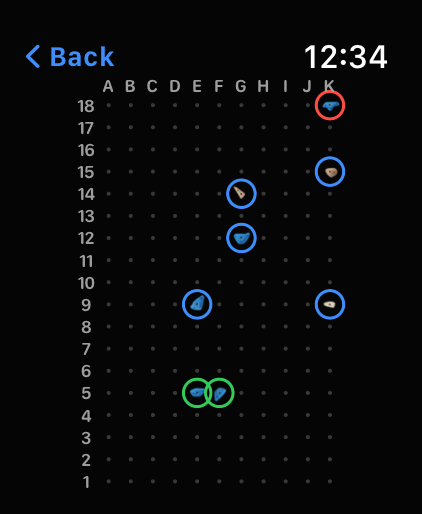
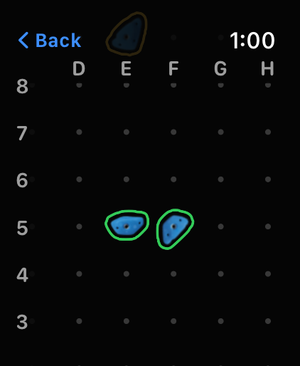

<p align="center">
  
</p>

<h1 align="center">Moondance</h1>

<p align="center">
  An Apple Watch app that lights up MoonBoard problems, logs attempts and sends,<br>
  and keeps track of projects — no iPhone or internet needed at the wall.
</p>

---

Moondance is a standalone app for the Apple Watch Ultra. It was built for the 40°
MoonBoard at Rocky Top Climbing in Charlottesville, which swaps between the **2016** and
**2024** hold sets. The watch talks to the board's LED box directly over Bluetooth, and
every problem ships inside the app, so it works with the phone left in the bag.

It's a personal project: the bundled problems are MoonBoard content, so the app is
installed through TestFlight and isn't published on the App Store.

**Version 1.0** · watchOS 26 · SwiftUI, SwiftData and Core Bluetooth · no third-party packages

## Contents

- [How it works](#how-it-works)
  - [Session](#session)
  - [Hold pictures](#hold-pictures)
  - [Lighting the board](#lighting-the-board)
  - [Logging attempts and sends](#logging-attempts-and-sends)
  - [Choosing problems](#choosing-problems)
  - [History](#history)
  - [Settings](#settings)
  - [Finding the board](#finding-the-board)
  - [Exporting your logs](#exporting-your-logs)
  - [Bluetooth log](#bluetooth-log)
- [How it talks to the board](#how-it-talks-to-the-board)
- [Problem data](#problem-data)
- [What's stored on the watch](#whats-stored-on-the-watch)
- [Building and running](#building-and-running)
- [Tests](#tests)
- [Project layout](#project-layout)
- [Known limits](#known-limits)

## How it works

The app opens on **Session**, built for standing at the wall. Swipe left for
**History** and **Settings**.

### Session


The hold grid fills the left side in the board's LED colors: **green** start holds,
**blue** hand holds and **red** finish holds. Row 18 is at the top, as on the wall.

- **Digital Crown** — turn it to step to the next or previous problem in the list.
- **Problem name** (top left, on the clock's line) — tap it to open the problem list.
  Long names wrap onto a second line and then end in "…".
- **Grade** with a white **B** badge for benchmarks.
- **Tries** — how many attempts you've logged on this problem (see below).
- **Proj** — tap the star to make it a project. Projects are pinned to the top of the list.
- **✎ Beta** — shows when the problem has beta (written on the holds in the hold
  pictures, below); tap it to open the hold pictures with **Show beta** on. Those
  holds get a small white dot on the grid.
- **Light it** — sends the problem to the board.
- **Tap the grid** for a full-screen look at the real holds (below).

<br clear="right">

### Hold pictures




Tap the hold grid on Session to see the problem with **pictures of the actual holds**:
only the problem's holds are shown, with the **start** holds outlined in green and the
**finish** in red (the outline follows each hold's own shape), faint dots where the
other holds are, and **A–K / 1–18** around the edge. Hand holds aren't outlined: with
every other hold hidden, there's nothing to mix them up with. Both hold sets have pictures: 2016 (sets A and B and the original school
holds) and 2024 (sets D, E and F and the wooden holds).

- **Digital Crown** — zoom in and out (up to 4×).
- **Drag** — pan around, a little past every edge so holds in the corners clear the
  screen's rounding. Zoomed in, the letters and numbers stay pinned to the top and
  left edges so you always know where you are.
- **Double-tap** — back to the whole board.
- **Long-press a hold** — mark your **high point**, the furthest hand hold you've
  reached. It's outlined in **gold**, and on Session it shows as a gold dot inside that
  hold's blue ring. A problem has one high point: marking another hold moves it, and
  long-pressing it again clears it. Start holds can't be a high point, and
  long-pressing the **finish** hold logs the problem as **sent**.
- **Tap a hold** — a callout opens beside it with its coordinates (such as **E9**),
  your **beta** for that hold (or "No beta yet") and a small **pen** to write or change
  it (keyboard, Scribble or dictation). Long beta wraps onto several lines. Edits
  save as you type; the back button returns to the board with no hold selected. The red button is **Cancel** the first time and **Remove** after that.
  Tap the hold again or anywhere else to close the callout. Holds with beta carry a
  small white mark.
- **Show beta** (on the clock's line, next to Back; gray when there's none) — every
  note in a bubble to the left or right of the board, level with its hold and joined
  to it by a line. Bubbles never overlap and their lines don't cross; pan sideways to
  read them. Zoomed in, they move with the board and disappear under the header. **Hide beta** puts them away.
- **‹ Back** (top left, on the clock's line) — back to Session.

<br clear="right">

### Lighting the board


Tap **Light it**. A small status line above the button shows what's happening, as a
dot plus a word so it reads in glare:

| Status | Meaning |
| --- | --- |
| 🔵 Connecting… / Sending… | talking to the LED box |
| 🟢 Lit | the problem is on the board; the button becomes **Clear** |
| 🔴 Failed | the button becomes **Retry**, and a red banner says what to do |

**Clear** turns every light off. Moondance always connects, sends and disconnects
straight away, so other climbers' phones can still reach the board.

<br clear="right">

### Logging attempts and sends


Logging happens on the tries count in the side column:

| Gesture | What it does |
| --- | --- |
| **Tap** the tries count | +1 attempt |
| **Touch and hold** it | mark **Sent** (a send also counts as an attempt) |
| **Touch and hold** a sent problem's **Sent** | unsend: the latest send becomes an attempt; earlier tries and sends stay |

Every log shows a short banner with **Undo** for 5 seconds. A problem can be sent more
than once. To fix anything older, edit the log from **History** (below).

If a save ever fails, a red banner says so and the error goes in the Bluetooth log.

<br clear="right">

### Choosing problems


Tap the problem name to open the **problem list** for the current hold set and grade.
Starred problems come first (newest star first), then the rest, most repeated first.
Each row shows the name, grade, **B** for benchmarks, a pen if it has beta, a star for projects, and either
a green check once it's sent or how many tries you've had. The current problem is
outlined in blue; tap any row to go to it.

The **grade chip** opens the grade picker: turn the Crown from **V4** to **V14** and
flip **Benchmarks only**. Changes apply straight away; the back arrow returns to the
list. The **hold set chip** opens Settings, and the **dice** jumps to a random problem
in the list.

The Crown on Session steps through problems in exactly the list's order.

<br clear="right">

### History


Your sessions, grouped by calendar day in the watch's time zone (no start or stop
button needed). Each day shows how many problems you tried, your attempts and your
sends, then one row per problem with its tries or a green **Sent**, and a gold
**High point** when you marked one that day. Tap a problem to open it on Session.

The **pen** on the right of a row fixes that problem's log for the day: it lists the
attempts, sends and high points. Tap an attempt or send to switch it, swipe anything
left to delete it, or **Delete all** (after asking). Deleting a high point here only
removes it from History; the current one stays. (Rows have no swipe actions, because
a sideways swipe on History changes page.)

History, the problem list and stars all follow the hold set chosen in Settings.

<br clear="right">

### Settings


- **Hold set** — 2016 or 2024 · 40°, to match what's on the wall.
- **Grades** — **V-Scale** (V5) or **Font** (6C+), used everywhere grades appear.
- **Stay open** — **Start climbing session** runs an indoor-climbing workout session,
  so raising your wrist shows Moondance instead of the clock. Health asks for
  permission the first time; nothing is saved to Health. It ends when you tap
  **End climbing session**, or after 3 hours.
- **Board** — the saved LED box and its ID, **Forget board**, and the **Bluetooth log**.
- **Your logs** — **Export logs**, with the date of the last export as a backup reminder.

<br clear="right">

### Finding the board


The first time you open the app (or tap Light it with no board saved), **Find board**
scans for MoonBoard LED boxes and lists them with their ID and signal strength. Pick one
and tap **Use this board**; it's saved, and later sessions connect to it automatically.
**Not now** skips it.

*(The screenshot comes from the simulator, which has no Bluetooth — hence the red note.)*

<br clear="right">

### Exporting your logs


Logs live only on the watch, so export them every few weeks. **Export logs** builds
`moondance-log.csv`, a complete backup: every attempt, send, project star, high point
marked and hold beta on both hold sets, with the problem's id. It opens the watch share sheet, so you
can send it by **Mail** or **Messages** over cellular.

```csv
date,time,hold_set,problem_id,problem,grade,type,hold,note
2026-11-08,18:30:00,2024,4f0c…,Dunes,V5 6C,attempt,,
2026-11-08,18:42:10,2024,4f0c…,Dunes,V5 6C,send,,
2026-11-08,18:45:00,2024,9a1e…,Calliope,V5 6C+,star,,
2026-11-08,18:50:12,2024,9a1e…,Calliope,V5 6C+,high_point,G13,
2026-11-08,19:02:40,2024,9a1e…,Calliope,V5 6C+,beta,E9,"Heel hook, then bump"
```

<br clear="right">

### Bluetooth log


Settings › Bluetooth log records every Bluetooth step and error, for troubleshooting at
the board. It has **Test send** (lights a fixed 2024 problem), **Clear board**, **Scan**,
an option to list every nearby device, an optional flags packet, and **Share log** to
send the whole log as text.

<br clear="right">

## How it talks to the board

The protocol comes from the community LED box emulator,
[e-sr/moonboard](https://github.com/e-sr/moonboard):

- The box offers the **Nordic UART** service (`6E400001-B5A3-F393-E0A9-E50E24DCCA9E`);
  Moondance writes to its RX characteristic (`6E400002-…`).
- A problem is one ASCII string, `l#` + comma-separated holds + `#`, e.g.
  `l#S67,S104,P79,P134,P120,P57,E90#`. **S** = start, **P** = hand, **E** = finish.
- Each number is the hold's position along the LED strip, snaking up column A, down
  column B and so on: A1 = 0 … A18 = 17, B18 = 18 … K18 = 197.
- The string is sent in 20-byte packets. Clear sends an empty problem, `l##`;
  on the real box that turns everything off except A1 (bottom-left).
- The box takes one connection at a time and stops advertising while someone is
  connected. Moondance listens for its advertising first (up to 3 s) and connects only
  when it hears it, then disconnects as soon as the problem is written. If the board is
  busy it says "Someone else has the board" rather than waiting in line to grab it.

Newer boxes (V3/V4, with a 12-digit ID) may not match the emulator exactly, and none of
this can be tested without the real board. [`GYM-CHECKS.md`](GYM-CHECKS.md) lists what
to check at the wall and what to try if something doesn't light.

## Problem data

All problems ship in [`Moon Dance Watch App/Resources/Problems.json`](Moon%20Dance%20Watch%20App/Resources/Problems.json),
built by [`tools/build_problems.py`](tools/build_problems.py) from the community catalog in
[boardhang/boardhang-app](https://github.com/boardhang/boardhang-app) (MIT, sourced from
the boardsesh API), pinned to one commit. For each hold set it keeps:

- every **benchmark**, at every grade, and
- the 300 most-repeated other problems at **V4** (6B, 6B+) and at **V5** (6C, 6C+).

| Hold set | Problems |
| --- | --- |
| 2016 · 40° | 1,172 |
| 2024 · 40° | 1,068 |

The dataset starts at 6B, so grades below V4 aren't offered. To refresh the problems,
rerun the script and rebuild — never edit `Problems.json` by hand:

```sh
python3 tools/build_problems.py
```

The hold pictures (`HoldImages-2016.png`, `HoldImages-2024.png` and `HoldImages.json`
in Resources) are built by [`tools/build_hold_images.swift`](tools/build_hold_images.swift)
from the per-hold-set layer images in [boardsesh](https://github.com/boardsesh/boardsesh)
(Apache-2.0), pinned to one commit. It finds each hold, fits the grid to them, cuts
every hold out on its own, traces an outline just outside each one, and checks that
every hold used by a problem has a picture.
The hold artwork itself is Moon Climbing's.

```sh
swift tools/build_hold_images.swift
```

## What's stored on the watch

- **Problems** (SwiftData, read-only) — loaded from `Problems.json` on first launch and
  replaced only when a new snapshot ships.
- **Logs** (`LogEntry`: problem, hold set, time, attempt or send), **projects**
  (`Project`: starred problems), **high points** (`HighPoint`: the current hold per
  problem, and `HighPointMark`: every marking, for History) and **beta**
  (`BetaNote`: a note pinned to one hold) — kept separately and keyed by the problem's
  id, so they survive a new snapshot.
- **Settings** (UserDefaults) — hold set, grade scale, saved board, last grade picked,
  Benchmarks only, last export date.

If the store can't be opened, Moondance shows an error screen instead of crashing. You
can carry on without saving, or start a new log. Starting a new log keeps the old files
on the watch under a `.broken-…` name.

## Building and running

Requirements: Xcode 27 or later, the watchOS 26 SDK, and the paid developer team for
signing. The app targets watchOS 26 on the Apple Watch Ultra and has no iPhone app.

Open `Moon Dance.xcodeproj` and run the **Moon Dance Watch App** scheme, or use the
scripts, which build and launch the app on their own **Moondance Tests** simulator
without the debugger:

| Script | What it does |
| --- | --- |
| `scripts/run.sh [shot.png] [args…]` | build, install and launch; optionally screenshot |
| `scripts/test.sh` | unit tests (a few seconds on a warm simulator) |
| `scripts/uitest.sh` | UI tests, e.g. Digital Crown stepping (about a minute and a half) |
| `scripts/shots.sh DIR name "args" …` | relaunch with launch arguments and screenshot each |
| `scripts/release.sh` | bump the build number, test, archive, upload to TestFlight and tag |
| `scripts/open.sh [--no-launch] [args…]` | build and open the app on your own simulator (the one in DeviceHub); `--no-launch` only installs it |
| `scripts/locked.sh command…` | run any other build or simulator command under the shared lock |

Every script waits for a lock shared with my other watch apps (`~/Library/Caches/watchapps-build.lock`, see [`scripts/lock.sh`](scripts/lock.sh)), so only one
build or test runs on the Mac at a time. A script that prints "Waiting for the shared build lock" is queued, not stuck.

Debug builds accept launch arguments for screenshots, e.g. `-openScreen list|grade|log|settings|find|export|preview|editor|beta`
(with `-previewSelect E9` and `-previewBeta YES` in the preview), `-openScreen holdBeta -betaHold E9`
(with `-previewZoom 3 -previewCentre 7,9` for a zoomed preview),
`-page history|settings`, `-demoBoard lit|failed|connecting`, `-demoBanner attempt|sent|unsend`
`-demoLogs YES`, `-demoHighPoint YES`, `-demoStoreError YES` (the store error screen) and
`-startClimbing YES`, `-demoBeta "E9=heel hook"`. `-uiTesting` starts with an empty in-memory store.

### Releasing through TestFlight

Commit everything, then run `scripts/release.sh`. The same script is used by all my
watch apps; per-app values are in [`scripts/app.env`](scripts/app.env). It:

1. refuses to run with uncommitted changes;
2. bumps `CURRENT_PROJECT_VERSION` on every target past the newest `build-N` git tag
   (each tag marks an uploaded build) and commits "Build N";
3. runs the unit tests (and the UI tests with `UI_TESTS=1`);
4. archives a Release build for any watchOS device, checks the archived build number
   and `ITSAppUsesNonExemptEncryption`, and uploads it as **TestFlight Internal Only**
   ([`scripts/ExportOptions.plist`](scripts/ExportOptions.plist)), signing with the
   Apple ID signed in to Xcode;
5. tags the commit `build-N`. `PUSH=1` also pushes the branch and the tag; `BUILD=N`
   picks the number.

Logs go to `build/release-tests.log`, `build/archive.log` and `build/export.log`. The
build appears under TestFlight in App Store Connect once it's processed.

Both targets keep `ITSAppUsesNonExemptEncryption = NO` and are signed with the paid team.

## Tests

- **91 unit tests** (Swift Testing): the board protocol and LED numbering, which box a
  job connects to and the timeout order, the problem snapshot and its loading (version
  read from the file's first bytes), list ordering, pinning and random picks, logging,
  undo, unsend and log editing, History's day grouping (with high points), CSV export,
  beta on holds and the Show beta bubble layout, settings, Bluetooth failure messages, the hold pictures and outlines
  (every problem hold has them), the preview's zoom and pan maths, and high points
  (one per problem, every marking recorded, start holds refused, the finish logs a
  send).
- **9 UI tests** (XCTest): Digital Crown stepping on launch, after opening the list,
  after swiping between pages and after the hold-picture preview (which the Crown
  zooms), that a small nudge doesn't skip a problem, long-pressing holds in the
  preview (high point, start hold refused) plus double-tap to reset the zoom, writing
  beta on a hold (and an empty grid point showing nothing), History's pen opening the
  log editor, and starting a climbing session after
  the Health prompt.

## Project layout

```
Moon Dance Watch App/
  Bluetooth/   BoardProtocol (message format), BoardManager (Core Bluetooth),
               BluetoothLog, BoardFailure, BoardIdentity
  Model/       SwiftData models, AppModel, SessionModel, Logbook, History,
               Grades, AppSettings, SnapshotLoader, LogExport, HoldImages
  Views/       Session, hold-picture preview, problem list, grade picker,
               History, Settings, Find board, Export, Bluetooth log
  Intents/     the "Light It" App Shortcut
  Resources/   Problems.json, hold picture sheets
Moon Dance Watch AppTests/     unit tests
Moon Dance Watch AppUITests/   UI tests
tools/         build_problems.py, build_hold_images.swift
scripts/       run, test, UI test, screenshot, open and release scripts, the shared lock
docs/          README images
GYM-CHECKS.md  what to verify at the board
SPEC.md        the spec
```

## Known limits

- **Bluetooth** works on the Rocky Top box (checked November 2026). Clear leaves the
  bottom-left light (A1) on. Only connecting when the board is free hasn't been checked
  at the wall yet; see [`GYM-CHECKS.md`](GYM-CHECKS.md).
- **Hold pictures** come from 650 × 1000 source images (about 50 pixels per grid
  cell), so they turn soft past about 3× zoom.
- **Action Button:** watchOS doesn't let an app read the Action Button or its long
  press, so logging is on screen only. The **Light It** shortcut can be assigned to the
  button (Watch › Settings › Action Button › Shortcut) or run with Siri.
- **Climbing session:** it starts in the simulator, but whether raising your wrist
  brings Moondance back (rather than the clock) can only be checked on the watch.
- **Export:** watchOS doesn't tell the app whether the share sheet actually sent the
  file, so "Last export" is the last time the share sheet was opened.
- The app's problem data and hold pictures are MoonBoard content shared by the
  community; they're for personal use.
