<p align="center">
  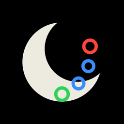
</p>

<h1 align="center">Moondance</h1>

<p align="center">
  An Apple Watch app that lights up MoonBoard problems, logs attempts and sends,<br>
  and keeps track of projects — no iPhone or internet needed at the wall.
</p>

---

Moondance is a standalone app for the Apple Watch Ultra. It was built for the 40°
MoonBoard at Rocky Top Climbing in Charlottesville, which swaps between the **2016** and
**2024** hold sets. The watch talks to the board's LED box directly over Bluetooth, and
every problem ships inside the app, so it works with the phone left in the bag.

It's a personal project: the bundled problems are MoonBoard content, so the app is
installed through TestFlight and isn't published on the App Store.

**Version 1.0** · watchOS 26 · SwiftUI, SwiftData and Core Bluetooth · no third-party packages

## Contents

- [How it works](#how-it-works)
  - [Session](#session)
  - [Lighting the board](#lighting-the-board)
  - [Logging attempts and sends](#logging-attempts-and-sends)
  - [Choosing problems](#choosing-problems)
  - [History](#history)
  - [Settings](#settings)
  - [Finding the board](#finding-the-board)
  - [Exporting your logs](#exporting-your-logs)
  - [Bluetooth log](#bluetooth-log)
- [How it talks to the board](#how-it-talks-to-the-board)
- [Problem data](#problem-data)
- [What's stored on the watch](#whats-stored-on-the-watch)
- [Building and running](#building-and-running)
- [Tests](#tests)
- [Project layout](#project-layout)
- [Known limits](#known-limits)

## How it works

The app opens on **Session**, built for standing at the wall. Swipe left for
**History** and **Settings**.

### Session

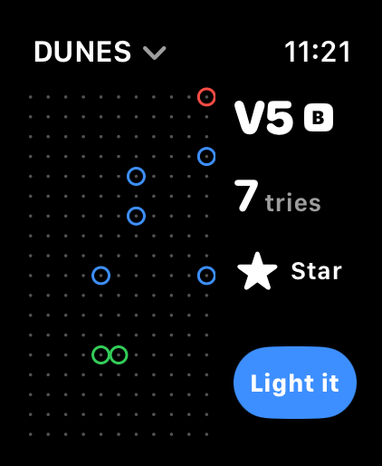

The hold grid fills the left side in the board's LED colors: **green** start holds,
**blue** hand holds and **red** finish holds. Row 18 is at the top, as on the wall.

- **Digital Crown** — turn it to step to the next or previous problem in the list.
- **Problem name** (top left, on the clock's line) — tap it to open the problem list.
  Long names wrap onto a second line and then end in "…".
- **Grade** with a white **B** badge for benchmarks.
- **Tries** — how many attempts you've logged on this problem (see below).
- **Star** — tap to make it a project. Starred problems are pinned to the top of the list.
- **Light it** — sends the problem to the board.

<br clear="right">

### Lighting the board

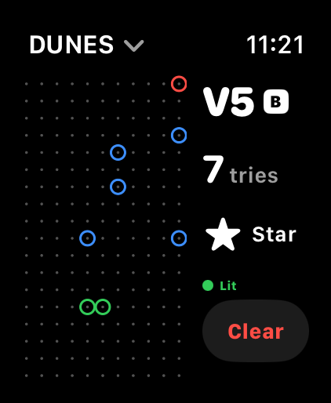
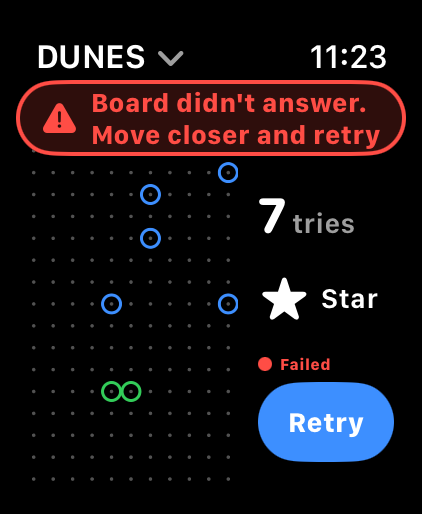

Tap **Light it**. A small status line above the button shows what's happening, as a
dot plus a word so it reads in glare:

| Status | Meaning |
| --- | --- |
| 🔵 Connecting… / Sending… | talking to the LED box |
| 🟢 Lit | the problem is on the board; the button becomes **Clear** |
| 🔴 Failed | the button becomes **Retry**, and a red banner says what to do |

**Clear** turns every light off. Moondance always connects, sends and disconnects
straight away, so other climbers' phones can still reach the board.

<br clear="right">

### Logging attempts and sends

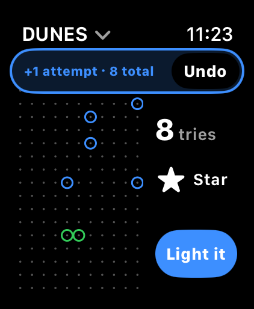

Logging happens on the tries count in the side column:

| Gesture | What it does |
| --- | --- |
| **Tap** the tries count | +1 attempt |
| **Touch and hold** it | mark **Sent** (a send also counts as an attempt) |
| **Touch and hold** a sent problem's **Sent** | unsend: clears that problem's log, back to 0 tries |

Every log shows a short banner with **Undo** for 5 seconds. Undoing an unsend puts every
attempt and send back with its original time. A problem can be sent more than once.

<br clear="right">

### Choosing problems

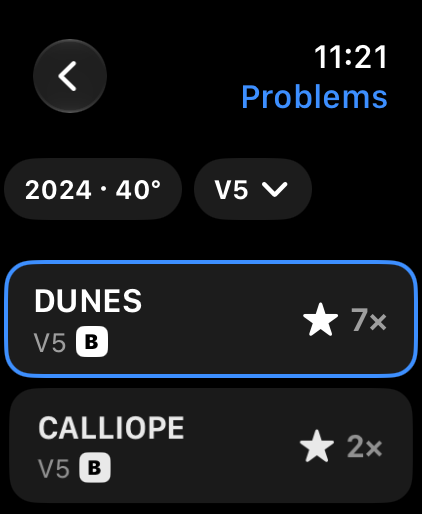
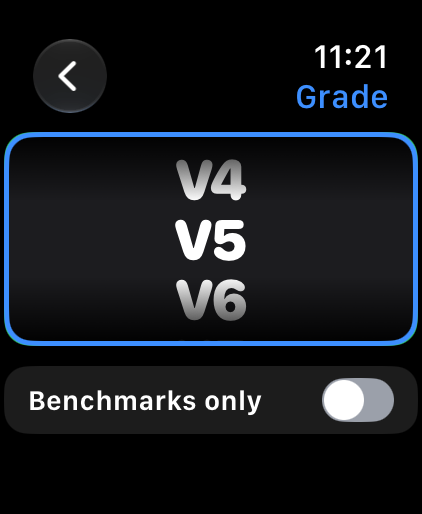

Tap the problem name to open the **problem list** for the current hold set and grade.
Starred problems come first (newest star first), then the rest, most repeated first.
Each row shows the name, grade, **B** for benchmarks, a star for projects, and either
a green check once it's sent or how many tries you've had. The current problem is
outlined in blue; tap any row to go to it.

The **grade chip** opens the grade picker: turn the Crown from **V4** to **V14** and
flip **Benchmarks only**. Changes apply straight away; the back arrow returns to the
list. The **hold set chip** opens Settings.

The Crown on Session steps through problems in exactly the list's order.

<br clear="right">

### History

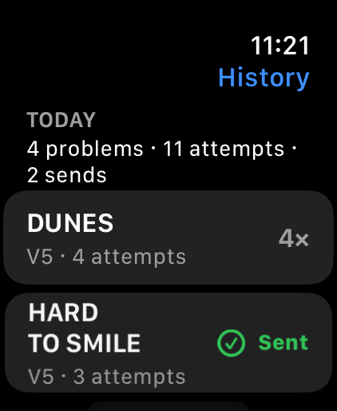

Your sessions, grouped by calendar day in the watch's time zone (no start or stop
button needed). Each day shows how many problems you tried, your attempts and your
sends, then one row per problem with its tries or a green **Sent**. Tap a problem to
open it on Session.

History, the problem list and stars all follow the hold set chosen in Settings.

<br clear="right">

### Settings

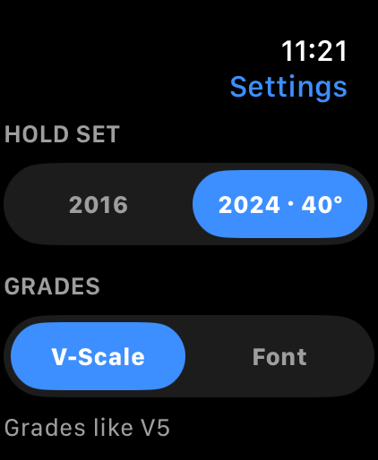

- **Hold set** — 2016 or 2024 · 40°, to match what's on the wall.
- **Grades** — **V-Scale** (V5) or **Font** (6C+), used everywhere grades appear.
- **Board** — the saved LED box and its ID, **Forget board**, and the **Bluetooth log**.
- **Your logs** — **Export logs**, with the date of the last export as a backup reminder.

<br clear="right">

### Finding the board

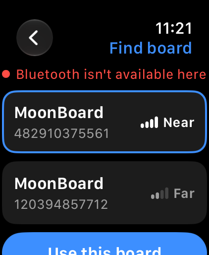

The first time you open the app (or tap Light it with no board saved), **Find board**
scans for MoonBoard LED boxes and lists them with their ID and signal strength. Pick one
and tap **Use this board**; it's saved, and later sessions connect to it automatically.
**Not now** skips it.

*(The screenshot comes from the simulator, which has no Bluetooth — hence the red note.)*

<br clear="right">

### Exporting your logs

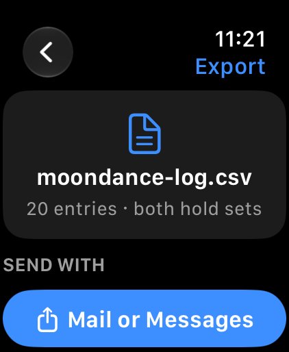

Logs live only on the watch, so export them every few weeks. **Export logs** builds
`moondance-log.csv` with every attempt and send on both hold sets and opens the watch
share sheet, so you can send it by **Mail** or **Messages** over cellular.

```csv
date,time,hold_set,problem,grade,type
2026-11-08,18:30:00,2024,Dunes,V5 6C,attempt
2026-11-08,18:42:10,2024,Dunes,V5 6C,send
```

<br clear="right">

### Bluetooth log

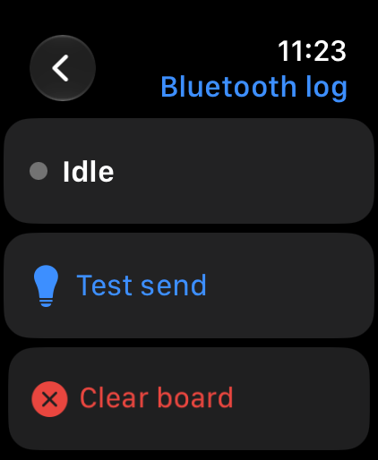

Settings › Bluetooth log records every Bluetooth step and error, for troubleshooting at
the board. It has **Test send** (lights a fixed 2024 problem), **Clear board**, **Scan**,
an option to list every nearby device, an optional flags packet, and **Share log** to
send the whole log as text.

<br clear="right">

## How it talks to the board

The protocol comes from the community LED box emulator,
[e-sr/moonboard](https://github.com/e-sr/moonboard):

- The box offers the **Nordic UART** service (`6E400001-B5A3-F393-E0A9-E50E24DCCA9E`);
  Moondance writes to its RX characteristic (`6E400002-…`).
- A problem is one ASCII string, `l#` + comma-separated holds + `#`, e.g.
  `l#S67,S104,P79,P134,P120,P57,E90#`. **S** = start, **P** = hand, **E** = finish.
- Each number is the hold's position along the LED strip, snaking up column A, down
  column B and so on: A1 = 0 … A18 = 17, B18 = 18 … K18 = 197.
- The string is sent in 20-byte packets. Clear sends an empty problem, `l##`.
- The box takes one connection at a time and stops advertising while someone is
  connected. Moondance listens for its advertising first (up to 3 s) and connects only
  when it hears it, then disconnects as soon as the problem is written. If the board is
  busy it says "Someone else has the board" rather than waiting in line to grab it.

Newer boxes (V3/V4, with a 12-digit ID) may not match the emulator exactly, and none of
this can be tested without the real board. [`GYM-CHECKS.md`](GYM-CHECKS.md) lists what
to check at the wall and what to try if something doesn't light.

## Problem data

All problems ship in [`Moon Dance Watch App/Resources/Problems.json`](Moon%20Dance%20Watch%20App/Resources/Problems.json),
built by [`tools/build_problems.py`](tools/build_problems.py) from the community catalog in
[boardhang/boardhang-app](https://github.com/boardhang/boardhang-app) (MIT, sourced from
the boardsesh API), pinned to one commit. For each hold set it keeps:

- every **benchmark**, at every grade, and
- the 300 most-repeated other problems at **V4** (6B, 6B+) and at **V5** (6C, 6C+).

| Hold set | Problems |
| --- | --- |
| 2016 · 40° | 1,172 |
| 2024 · 40° | 1,068 |

The dataset starts at 6B, so grades below V4 aren't offered. To refresh the problems,
rerun the script and rebuild — never edit `Problems.json` by hand:

```sh
python3 tools/build_problems.py
```

## What's stored on the watch

- **Problems** (SwiftData, read-only) — loaded from `Problems.json` on first launch and
  replaced only when a new snapshot ships.
- **Logs** (`LogEntry`: problem, hold set, time, attempt or send) and **projects**
  (`Project`: starred problems) — kept separately and keyed by the problem's id, so
  they survive a new snapshot.
- **Settings** (UserDefaults) — hold set, grade scale, saved board, last grade picked,
  Benchmarks only, last export date.

## Building and running

Requirements: Xcode 27 or later, the watchOS 26 SDK, and the paid developer team for
signing. The app targets watchOS 26 on the Apple Watch Ultra and has no iPhone app.

Open `Moon Dance.xcodeproj` and run the **Moon Dance Watch App** scheme, or use the
scripts, which build and launch the app on their own **Moondance Tests** simulator
without the debugger:

| Script | What it does |
| --- | --- |
| `scripts/run.sh [shot.png] [args…]` | build, install and launch; optionally screenshot |
| `scripts/test.sh` | unit tests (a few seconds on a warm simulator) |
| `scripts/uitest.sh` | UI tests, e.g. Digital Crown stepping (about a minute and a half) |
| `scripts/shots.sh DIR name "args" …` | relaunch with launch arguments and screenshot each |

Debug builds accept launch arguments for screenshots, e.g. `-openScreen list|grade|log|settings|find|export`,
`-page history|settings`, `-demoBoard lit|failed|connecting`, `-demoBanner attempt|sent|unsend`
and `-demoLogs YES`. `-uiTesting` starts with an empty in-memory store.

### Releasing through TestFlight

1. Bump the build number (`CURRENT_PROJECT_VERSION`) on every target.
2. In Xcode, choose **Any watchOS Device**, then **Product › Archive**.
3. In the Organizer: **Distribute App › TestFlight Internal Only**.

Both targets keep `ITSAppUsesNonExemptEncryption = NO` and are signed with the paid team.

## Tests

- **57 unit tests** (Swift Testing): the board protocol and LED numbering, the problem
  snapshot and its loading, list ordering and pinning, logging, undo and unsend,
  History's day grouping, CSV export, settings and Bluetooth failure messages.
- **4 UI tests** (XCTest): Digital Crown stepping on launch, after opening the list,
  after swiping between pages, and with a small turn.

## Project layout

```
Moon Dance Watch App/
  Bluetooth/   BoardProtocol (message format), BoardManager (Core Bluetooth),
               BluetoothLog, BoardFailure, BoardIdentity
  Model/       SwiftData models, AppModel, SessionModel, Logbook, History,
               Grades, AppSettings, SnapshotLoader, LogExport
  Views/       Session, problem list, grade picker, History, Settings,
               Find board, Export, Bluetooth log
  Intents/     the "Light It" App Shortcut
  Resources/   Problems.json
Moon Dance Watch AppTests/     unit tests
Moon Dance Watch AppUITests/   UI tests
tools/         build_problems.py
scripts/       run, test, UI test and screenshot helpers
docs/          README images
GYM-CHECKS.md  what to verify at the board
SPEC.md        the original spec
```

## Known limits

- **Bluetooth hasn't been tried on the real board yet.** Position numbering, Clear and
  newer box versions are the main unknowns; see [`GYM-CHECKS.md`](GYM-CHECKS.md).
- **Action Button:** watchOS doesn't let an app read the Action Button or its long
  press, so logging is on screen only. The **Light It** shortcut can be assigned to the
  button (Watch › Settings › Action Button › Shortcut) or run with Siri.
- **Export:** watchOS doesn't tell the app whether the share sheet actually sent the
  file, so "Last export" is the last time the share sheet was opened.
- The app's problem data is MoonBoard content shared by the community; it's for
  personal use.
